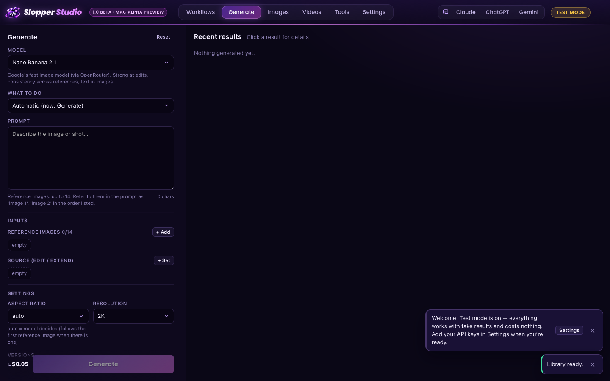
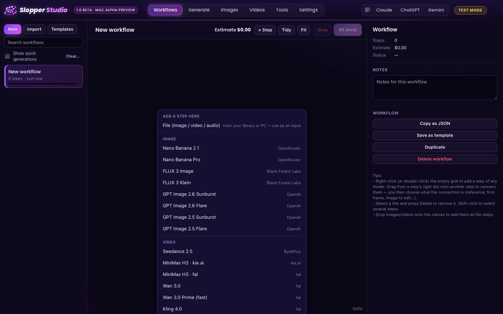
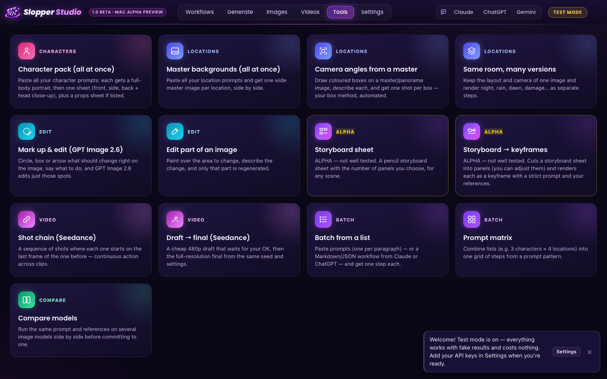

# Slopper Studio — downloads

**Your own AI image & video studio, on your own API keys.** Type a prompt and press Generate — or build node workflows
when you need more. Seedance 2.5, Kling 4.0, MiniMax H3, Topview T1, GPT Image 2.6, Nano Banana and FLUX 3 in one desktop app,
with a library, a frame-accurate video player and ready-made tools (character packs, master backgrounds, camera angles
from a master, mark-up edits, storyboards).

- **Pay the providers directly** — no subscription, no markup. Every generation shows its estimated cost first.
- **Simple or advanced** — a plain prompt screen for quick shots, node workflows for whole sequences.
- **Claude / ChatGPT can write your workflows** and send them into the app — but only *you* can press Run.
- **Test mode** — try everything with fake results before adding any keys.

| | Download | Version |
|---|---|---|
| **Windows 10 / 11** | **[⬇ Slopper Studio Setup.exe](https://github.com/SakoKiller1986/Slopper-studio-releases/raw/main/downloads/Slopper-Studio-Setup.exe)** | 1.0 Beta (build 2026.11.08.6) |
| **macOS — Alpha Preview** (Apple Silicon M1 or newer, macOS 12+) | **[⬇ Slopper-Studio-Mac.dmg](https://github.com/SakoKiller1986/Slopper-studio-releases/raw/main/downloads/Slopper-Studio-Mac.dmg)** | 1.0 Beta · Mac Alpha Preview (build 2026.11.08.6) |

### Windows
Run the installer and choose where to install. If Windows says "Windows protected your PC", click **More info → Run anyway**.
The first time it opens, it asks where to keep your library.

### Mac (Alpha Preview)
Early version — tested on GitHub's Mac machines, not yet by many people. Please report problems.
1. Open the .dmg and drag **Slopper Studio** onto **Applications**.
2. Open it once. macOS will block it (the app isn't signed with an Apple Developer certificate yet).
3. Go to **System Settings → Privacy & Security**, scroll down and click **Open Anyway** (older macOS: right-click the app → Open). Needed only once.

On Mac, the Claude / ChatGPT / Gemini buttons open those apps in their own windows (the side-panel dock is Windows-only),
and free local upscaling is Windows-only for now. Intel Macs aren't supported.

### Updates
The app tells you when a new version is out: Settings → Updates → Check for updates.

## Licence

Free to use, not open source. © 2026 SakoKiller1986 — all rights reserved.
Please don't re-share the installer; send people to this page instead. The licence is shown in the installer.
